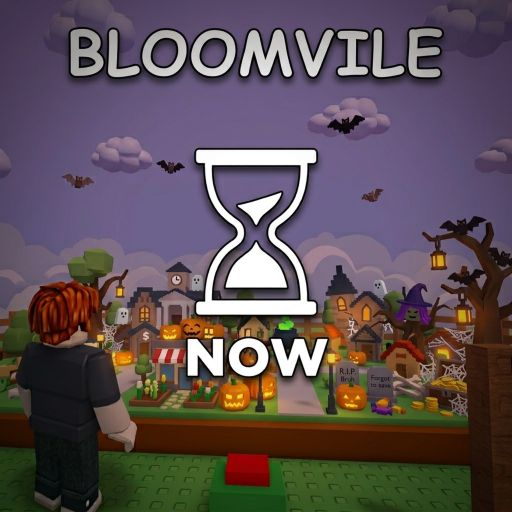
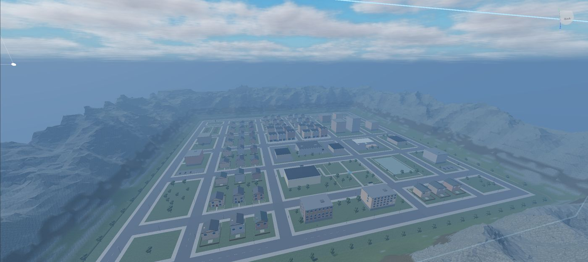
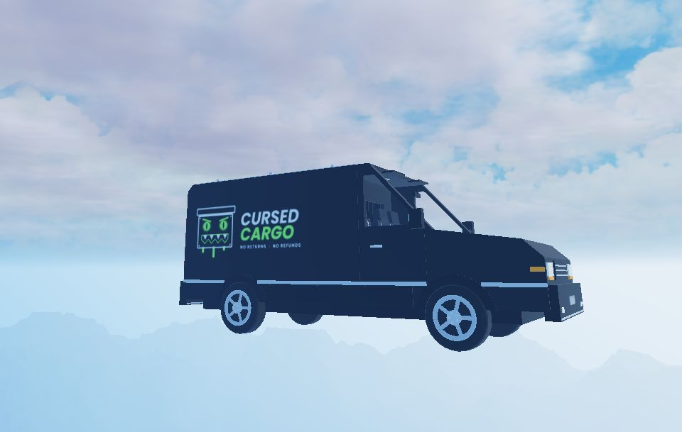
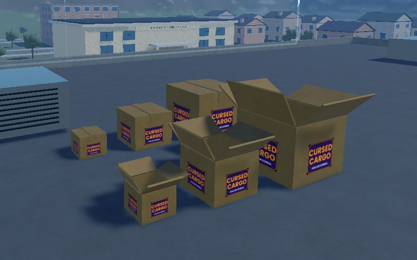
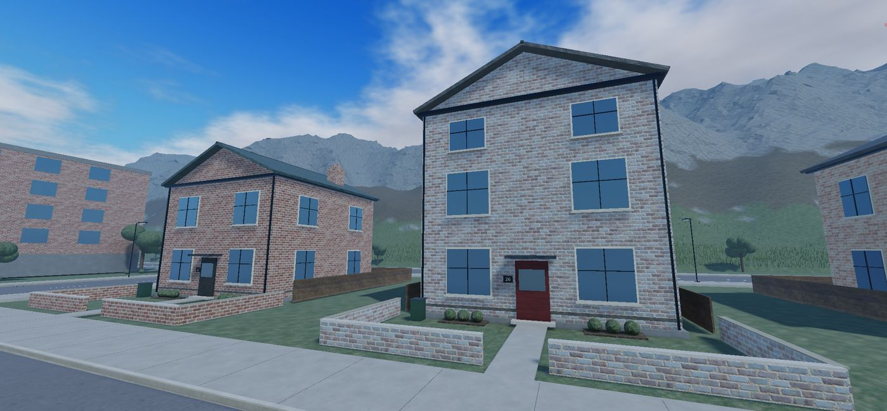
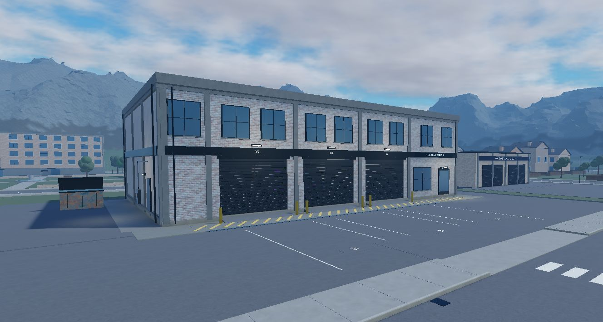
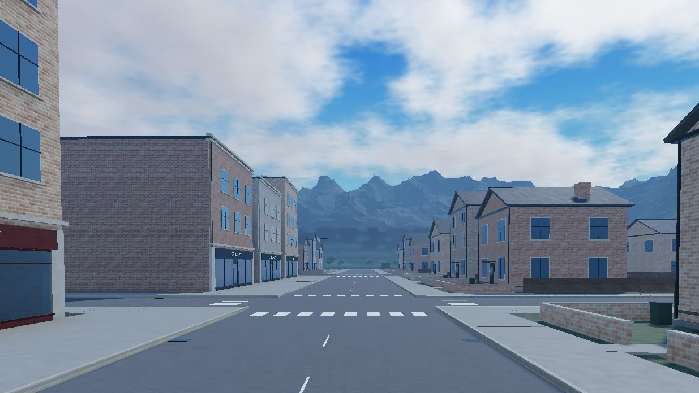

<!doctype html>
<html lang="en">
<head>
<meta charset="utf-8">
<meta name="viewport" content="width=device-width, initial-scale=1">
<title>Rapture Studios | Roblox Developer Portfolio</title>
<meta name="description" content="Rapture Studios (rapture-rblx): Roblox soundtracks, sound effects and scripting. Games worked on and games in development.">
<meta property="og:title" content="Rapture Studios">
<meta property="og:description" content="Roblox soundtracks, SFX and scripts. Bloomville, Cursed Cargo and more.">
<link rel="icon" href="data:image/svg+xml,%3Csvg xmlns='http://www.w3.org/2000/svg' viewBox='0 0 64 64'%3E%3Crect width='64' height='64' rx='14' fill='%230b0d10'/%3E%3Cpath d='M20 48V16h14a10 10 0 0 1 3 19.6L46 48h-8l-7-11h-5v11z M26 22v9h8a4.5 4.5 0 0 0 0-9z' fill='%2362ff8a'/%3E%3C/svg%3E">

</head>
<body>

<nav>

  <a class="logo" href="#top"><i></i>Rapture Studios</a>
  
<a href="#work">Work</a><a href="#games">Games</a><a href="#wip">In development</a><a href="#contact">Contact</a>

</nav>

<header class="hero" id="top">

  
<b>rapture-rblx</b> · Roblox developer

  <h1>Sound, scripts &amp; <em>worlds</em> for Roblox.</h1>
  
I'm Daniel, the developer behind Rapture Studios. I make soundtracks, sound effects and game scripts for Roblox experiences.

  

    <a class="btn primary" href="#games">See my games</a>
    <a class="btn" href="#bloomville-music">Listen to soundtracks</a>
  

</header>

<section id="work">

  What I do
  <h2>Examples of work</h2>
  
Everything an experience needs to sound and play right, from music to the code behind it.

  

    

<svg width="24" height="24" viewBox="0 0 24 24" fill="none" stroke="currentColor" stroke-width="2" stroke-linecap="round" stroke-linejoin="round"><path d="M9 18V5l12-2v13"/><circle cx="6" cy="18" r="3"/><circle cx="18" cy="16" r="3"/></svg>

      <h3>Soundtracks</h3>
Looping, themed music built for specific islands and moods. Hear the Bloomville tracks <a href="#bloomville-music" style="color:var(--accent)">below</a>.

      
Themed loopsSeasonal musicGame ready

    

<svg width="24" height="24" viewBox="0 0 24 24" fill="none" stroke="currentColor" stroke-width="2" stroke-linecap="round" stroke-linejoin="round"><path d="M11 5 6 9H2v6h4l5 4z"/><path d="M15.5 8.5a5 5 0 0 1 0 7M19 5a10 10 0 0 1 0 14"/></svg>

      <h3>Sound effects</h3>
SFX for gameplay feedback, ambience and upgrades, from small UI clicks to big moments.

      
Gameplay SFXAmbienceUI sounds

    

<svg width="24" height="24" viewBox="0 0 24 24" fill="none" stroke="currentColor" stroke-width="2" stroke-linecap="round" stroke-linejoin="round"><path d="m16 18 6-6-6-6M8 6l-6 6 6 6"/></svg>

      <h3>Scripts</h3>
Luau scripting for game systems, features and tools that run reliably in live servers.

      
LuauGame systemsRoblox Studio

  

</section>

<section id="games" class="alt">

  Games I've worked on
  <h2>Released work</h2>
  

    

    

      Worked on
      <h3>Bloomville</h3>
      
A Roblox experience with a cosy, seasonal town that changes with the calendar, from Halloween pumpkins and bats to a main island and a desert.

      
I composed the soundtrack, with a separate theme for each area.

      
SoundtrackRoblox

      

        
Bloomville soundtrack4 tracks

        

      

    

  

</section>

<section id="wip">

  Games I'm working on
  <h2>In development</h2>
  

    In development
    <h3 style="font-size:clamp(2rem,5vw,3.4rem);margin-bottom:12px">Cursed Cargo</h3>
    
A co-op delivery game where your packages are alive and cursed. Load up the van, work as a team and get every parcel to its door. <b style="color:var(--accent)">No returns. No refunds.</b>

  

  

    <button>The town from above</button>
    <button>The delivery van</button>
    <button>The cursed packages</button>
    <button>Delivery addresses</button>
    <button>The depot</button>
    <button>Main street</button>
  

  

    
<b>Co-op</b>Work with friends to get every delivery done.

    
<b>Living packages</b>Cursed parcels that don't want to be delivered.

    
<b>Drive and deliver</b>A custom van, a depot and a whole town to cover.

  

</section>

<section id="contact" class="alt contact">

  Get in touch
  <h2>Need sound or scripts for your game?</h2>
  
I'm open to Roblox soundtrack, SFX and scripting work. Join the studio Discord or follow along on YouTube and TikTok.

  

    <a class="btn primary" href="https://discord.gg/arvm99rawt" target="_blank" rel="noopener">Join Rapture Studios on Discord</a>
    <a class="btn" href="https://youtube.com/@raprblx" target="_blank" rel="noopener">YouTube</a>
    <a class="btn" href="https://www.tiktok.com/@rapturedevelopment?_r=1&amp;_t=ZN-9AS47enZy5u" target="_blank" rel="noopener">TikTok</a>
  

</section>

<footer>
&copy;  Rapture Studiosrapture-rblx
</footer>

<button aria-label="Close">&times;</button>

</body>
</html>
